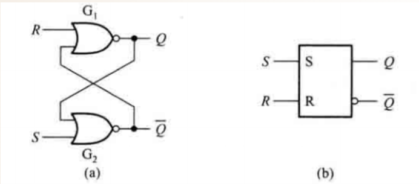

# 3-x2 From a Circuit to a Programmable Device

> This page is the physical counterpart of 3-x1. That page asked how we got here; this one asks how it actually runs, right now. It is the hardest page in the appendix set, it sets no assignment, and it asks you to hold one chain in your head: **voltage on the address bus → decoder → chip select → register latch → comparator → square wave on a pin → transistor switching → motor speed.** Not one link on that chain is abstract. Every link is a voltage on a wire. Skip what does not land, but come back and walk the chain once — later, when we talk about drivers, `/dev`, and "everything is a file", having this chain in your head is the difference between two courses.

> 上一页讲的是「怎么走到今天」，这一页讲「此刻到底怎么转起来的」。它回答的是同一个问题的物理层版本：一个造好的电路，凭什么能被一行代码指挥？
>
> 这一页比前几页都硬。它不要求你背，也不布置作业。它要求你在读完以后，能在脑子里放一遍下面这条链：**地址总线上的电平 → 译码器 → 片选 → 寄存器锁存 → 比较器 → 引脚方波 → 管子开关 → 电机转速。** 这条链上没有任何一处是「抽象的」，每一环都是某根导线上的电压。看不懂的地方可以跳，但跳完请回来把这条链走通一次——后面讲驱动、讲 `/dev`、讲「一切皆文件」的时候，你脑子里有这条链和没有，是完全两门课。

---

## 3.2.0 Terms you will meet

Every abbreviation on this page, in one place. Come back here instead of scrolling back.

A trailing `#` means *active low*: the signal is asserted when the line sits at 0 V, not at supply voltage.

> 这一页会用到的所有缩写，集中在这里。要查就翻回这张表，不用往上翻正文。名字后面带 `#` 表示**低有效**：线在 0 V 时这个信号才算成立。

**Pins and signals.**

| Mark              | Full name                  | 中文      | What it does                                                                            |
| :---------------- | :------------------------- | :------ | :-------------------------------------------------------------------------------------- |
| `VCC`             | supply voltage (collector) | 电源正极    | powers the chip; no supply, no logic                                                    |
| `GND`             | ground                     | 地       | the return path for every signal                                                        |
| `A0–An`           | address lines              | 地址线     | carry the address into the internal decoder                                             |
| `D0–D7`           | data lines                 | 数据线     | carry the value; direction set by read or write                                         |
| `CS#`             | **Chip Select**            | 片选      | the only signal that says "you are chosen"; while it is high, nothing else is looked at |
| `OE#`             | **Output Enable**          | 输出使能    | only when asserted may the chip drive the data lines                                    |
| `WE#`             | **Write Enable**           | 写使能     | asserted means "latch what is on the data lines"                                        |
| `RD#`             | **Read**                   | 读选通     | the read counterpart of `WE#`                                                           |
| `ALE`             | **Address Latch Enable**   | 地址锁存使能  | tells the far side to grab the address before the lines are reused                      |
| `CLK`             | **Clock**                  | 时钟      | the beat; synchronous parts move on its edge                                            |
| `RESET#`          | **Reset**                  | 复位      | forces every internal flip-flop into a known state                                      |
| `READY` / `WAIT#` | ready / wait               | 就绪 / 等待 | handshake: "done" or "still working, keep waiting"                                      |
| `Hi-Z`            | **high impedance**         | 高阻      | electrically, the pin is connected to nothing                                           |

**Devices and memory.**

| Term            | Full name                                         | 中文           | Note                                                    |
| :-------------- | :------------------------------------------------ | :----------- | :------------------------------------------------------ |
| `BJT`           | Bipolar Junction Transistor                       | 双极型三极管       | current-controlled; the older logic family              |
| `MOSFET`        | Metal-Oxide-Semiconductor Field-Effect Transistor | 金属氧化物半导体场效应管 | voltage-controlled; the one that won                    |
| `CMOS`          | Complementary MOS                                 | 互补 MOS       | NMOS + PMOS in pairs; near-zero static power            |
| `TTL`           | Transistor-Transistor Logic                       | 晶体管-晶体管逻辑    | the 74-series family; still the standard for glue logic |
| `SRAM`          | Static Random Access Memory                       | 静态随机存储器      | six transistors per bit; cache                          |
| `DRAM`          | Dynamic Random Access Memory                      | 动态随机存储器      | one transistor plus one capacitor; needs refresh        |
| `RAS#` / `CAS#` | Row / Column Address Strobe                       | 行 / 列地址选通    | DRAM splits one address into two transfers              |
| `CL`            | CAS Latency                                       | 列地址延迟        | how many cycles until column data appears               |
| `tRCD` / `tRP`  | RAS-to-CAS Delay / Row Precharge                  | 行到列延迟 / 行预充电 | nanosecond numbers on a memory stick's label            |
| `PWM`           | Pulse-Width Modulation                            | 脉宽调制         | vary the duty cycle, vary the average voltage           |
| `TACH`          | tachometer                                        | 转速计          | the fan's speed signal, usually two pulses per turn     |

**Architecture and software.**

| Term   | Full name                    | 中文       | Note                                                  |
| :----- | :--------------------------- | :------- | :---------------------------------------------------- |
| `ISA`  | Instruction Set Architecture | 指令集架构    | the dialect a CPU understands                         |
| `ALU`  | Arithmetic Logic Unit        | 算术逻辑单元   | the part that adds, subtracts, ANDs, ORs              |
| `FSM`  | **Finite State Machine**     | 有限状态机    | the proper name for "a chip's little state diagram"   |
| `MMIO` | **Memory-Mapped I/O**        | 内存映射 I/O | device registers placed in the address space          |
| `PIO`  | Port I/O                     | 端口 I/O   | x86's separate 64 KB space, reached with `in` / `out` |
| `MMU`  | Memory Management Unit       | 内存管理单元   | translates virtual addresses into physical ones       |

**State names.** Conventions, not standards; different datasheets choose different words for the same idea.

| State                         | 中文           | Meaning                                         |
| :---------------------------- | :----------- | :---------------------------------------------- |
| `IDLE`                        | 空闲           | nothing selected, outputs high-impedance        |
| `SELECTED`                    | 已选中          | `CS#` asserted, waiting to learn read or write  |
| `WRITE` / `READ`              | 写 / 读        | the data transfer itself                        |
| `ACTIVATE`                    | 行激活          | DRAM: open one row into the row buffer          |
| `PRECHARGE`                   | 预充电          | DRAM: close the open row before opening another |
| `ARMED` / `RUNNING` / `FAULT` | 就绪 / 运行 / 故障 | a device's own lifecycle                        |

---

## 3.2.1 One transistor: why MOS and not BJT

All of digital electronics rests on one object: a switch an electrical signal can open. There are two ways to build such a switch, and history picked one for very concrete reasons.

A **BJT** (bipolar junction transistor) is *current controlling current*: push a current into the base, and a larger current can flow between collector and emitter. Its problem is that **the base current never stops**. That current does no work; it is simply burnt. A gate built from BJTs — the old TTL family — therefore dissipates milliwatts while sitting still, and a chip with tens of thousands of gates hits a thermal wall at once.

A **MOSFET** (metal-oxide-semiconductor field-effect transistor) is *voltage controlling current*. Between the gate and the channel below lies an extremely thin layer of silicon dioxide — which is, electrically, **a capacitor**. Apply a voltage and the field pulls carriers into the channel or pushes them out, so the source-to-drain path conducts or blocks. The crucial part: **no current flows through the gate.** It only charges and discharges that capacitance at the instant of switching. At steady state the gate draws almost nothing.

That one difference decides everything downstream:

|                 | BJT                           | MOSFET                                        |
| :-------------- | :---------------------------- | :-------------------------------------------- |
| Controlled by   | base **current**              | gate **voltage**                              |
| Static power    | high (base current, always)   | almost zero (only gate capacitance)           |
| Input impedance | low                           | very high (insulated gate)                    |
| Area            | large                         | small                                         |
| Process         | tight control of current gain | only NMOS and PMOS; fewer steps, better yield |

**CMOS** (complementary MOS) takes this to its limit: every gate pairs one NMOS with one PMOS. With a high input the PMOS is off and the NMOS on, pulling the output low; with a low input it is the other way round. **In any steady state one of the two is always off, so there is no path from supply to ground** — static power lands in the nanowatt range, and power is spent only while switching. The billions of transistors in your CPU stay alive because of that property.

A MOSFET is not an ideal switch, though. Three non-idealities set the speed ceiling of every computer:

- **On-resistance.** Conducting is not 0 Ω; it is tens to hundreds of ohms. Charging a capacitance therefore carries an RC time constant.
- **Gate capacitance.** Every transition charges and discharges it. Power grows with *capacitance × voltage² × frequency* — which is why overclocking needs more voltage, and more voltage means more heat.
- **Threshold voltage.** It does not switch on with "a bit of electricity"; you must cross a threshold. That buys noise margin and costs delay.

> A number worth keeping: at 3 GHz one clock period is 0.33 ns. In that time light travels about ten centimetres — less inside silicon and PCB dielectric. **So a chip cannot simply be made bigger: not because it cannot be manufactured, but because the signal cannot cross it in one tick.** Every "clock tree", "pipeline stage" and "cache level" you will meet is a fight against that constant.

> 数字电路的一切，都建立在「一个能被电信号打开的开关」上。这种开关有两种做法，而历史选了其中一种，理由很具体。
>
> **三极管（BJT，双极型）**&#x662F;「电流控制电流」：往基极灌一股电流，集电极和发射极之间就能通过更大的电流。它的问题是——**基极必须一直有电流**。这个电流不做功，纯烧掉。所以用 BJT 搭的逻辑门（老的 TTL 工艺），一个门静态就要几毫瓦到几十毫瓦，一块芯片上几万个门，热量直接封顶。
>
> **MOS 管（场效应管）**&#x662F;「电压控制」：栅极和下面的沟道之间隔着一层极薄的二氧化硅——它本质上是个**电容**。给栅极加电压，电场把沟道里的载流子吸过来或推开，源极和漏极之间就导通或截止。关键在于，**栅极不流过电流**，只在翻转的那一瞬间给这个电容充放电。稳定状态下，栅极几乎不耗电。
>
> **CMOS**（互补 MOS）把这一点用到了极致：每个逻辑门都用一个 NMOS 和一个 PMOS 成对搭。输入是高电平时 PMOS 关、NMOS 开，输出被拉到低；输入是低电平时反过来。**任何稳定状态下，总有一个管子是关的，电源到地之间没有直通路**，所以静态功耗是纳瓦级——只有翻转时才耗电。今天你 CPU 里几十亿个管子，靠的就是这条性质活着。
>
> 但 MOS 不是理想开关，它有三个必须记住的非理想性，它们直接决定了电脑的速度上限：**导通电阻**——导通时不是 0 欧姆，有几十到几百欧姆，要给电容充电就有 RC 时间常数；**栅极电容**——每次翻转都要充放电，频率越高电流越大，功耗正比于「电容 × 电压² × 频率」，这就是为什么超频要加压、加压就发热；**阈值电压**——不是「加一点电就开」，要超过一个门槛，这带来噪声容限，也带来延迟。
>
> 一个能记住的数字：3 GHz 的 CPU，一个时钟周期是 0.33 纳秒。光在这段时间里只能走十几厘米（在硅和 PCB 介质里更短）。**所以芯片不能做得更大——不是造不出来，是电信号来不及跑完一圈。** 你以后听到「时钟树」「流水线」「缓存分级」，全是在跟这个物理常数搏斗。

## 3.2.2 Holding a number: latches, flip-flops, two kinds of memory

With switches in hand, the first thing you build is a **combinational circuit**: the output depends only on the present input. Adders, comparators and decoders are all of this kind — no memory; change the input and the output follows at once.

But a computer must **keep** things. The physical starting point of storage is a counter-intuitive trick: **cross-couple the outputs of two NOR gates into each other's inputs.**

```text
        ┌──────┐
   S ──▶│ NOR  │──┐
        └──────┘  │
             ▲    ├──▶ Q
             │    │
        ┌──────┐  │
   R ──▶│ NOR  │──┘
        └──────┘
             ▲
             └──── Q' wired back into the upper gate's input
```


This is an **SR latch**. Its virtue: give S a pulse and Q goes high; remove the pulse and Q *stays* high, held up by its own output — **the circuit has bitten its own tail.** That is the whole secret of storage: not trapping charge in a cage, but building a loop that sustains itself.

Put a clock-controlled gate in front of it and you get a **D flip-flop**: on the rising clock edge the input D is sampled, and Q holds that value until the next edge. One flip-flop stores 1 bit. Eight side by side make an 8-bit register — **the physical form of the "register" inside a CPU, and the thing every "write a byte to this address" eventually lands in.**

The two kinds of memory differ in exactly how that one bit is kept:


|                      | SRAM (cache)                  | DRAM (main memory)                                      |
| :------------------- | :---------------------------- | :------------------------------------------------------ |
| Devices per bit      | six MOSFETs (a latch loop)    | one MOSFET plus one capacitor                           |
| What holds the value | the loop, kept alive by power | charge on the capacitor                                 |
| Forgetting           | never, while powered          | leaks; must be refreshed every few tens of milliseconds |
| Speed                | nanoseconds                   | tens of nanoseconds                                     |
| Density and cost     | low density, expensive        | high density, cheap                                     |

> One line: **cache bites a bit down with six transistors; main memory stores a bit as charge on a capacitor and has to keep topping it up.** That is why cache is small, fast and expensive while memory is large, slow and cheap. The memory pyramid is not a designed hierarchy of rank; it is the price difference between two devices.

> 有了开关，先做**组合电路**：输出只由当前输入决定。加法器、比较器、译码器都是这一类——它们没有记忆，输入一变，输出立刻跟着变。
>
> 但计算机必须能**存**东西。存储的物理起点是一个反直觉的技巧：**把两个或非门的输出交叉接到对方的输入上。** 这个结构叫 **SR 锁存器**。它的妙处在于：只要给 S 一个脉冲，Q 就变高；撤掉脉冲之后，Q 靠自己的输出维持住——**电路自己咬住了自己的尾巴**。这就是「存储」的全部秘密：不是把电荷关进笼子，而是搭一个能自我维持的环路。
>
> 在它前面加一个**时钟**控制的门，就成了 **D 触发器**：只有时钟上升沿那一刻，输入 D 才被采进去，其余时间输出 Q 保持不变。一个 D 触发器存 1 bit。八个并排，就是一个 8 位寄存器——**这就是 CPU 里那些「寄存器」的物质形态，也是后面所有「往某个地址写一个字节」最终落到的东西。**
>
> 两种存储器，就差在这 1 bit 怎么存：**SRAM** 用 6 个管子搭锁存环路，靠电源维持，不断电就不忘，纳秒级，低密度、贵；**DRAM** 用 1 个管子加 1 个电容，靠电容上的电荷，会漏电、必须周期性刷新（几十毫秒一轮），几十纳秒，高密度、便宜。
>
> 一句话：**缓存是「用六个管子咬住一位」，内存是「用一个电容攒住一点电荷，还得不停地给它续上」。** 存储金字塔不是设计出来的等级制度，是这两种器件的物理差价。

## 3.2.3 Selecting number 12345: a decoder is an address

Take a chip holding 1048576 eight-bit cells. How does the CPU say "I want number 12345"?

By **twenty wires, each high or low, forming a 20-bit binary number.** 2²⁰ = 1048576, exactly that many. An address is not a number travelling along a wire; it is a set of voltages present on twenty wires at the same instant.

The chip's job is to turn that combination into "which of the 1048576 horizontal lines do I light up". The circuit that does it is a **decoder**, and it is nothing but a thicket of AND gates.

The smallest one, two inputs and four outputs:

|  A1 |  A0 | Asserted output |
| :-: | :-: | :-------------- |
|  0  |  0  | Y0              |
|  0  |  1  | Y1              |
|  1  |  0  | Y2              |
|  1  |  1  | Y3              |

Four AND gates, each fed with A1 and A0 straight or inverted. Y1 = (¬A1) ∧ A0, for instance, goes high only when A1=0 and A0=1. **At any instant exactly one of the four outputs is high and the rest are low.** Feed twenty address lines into a deeper tree of the same gates and you get 1048576 **word lines**, exactly one of them high at a time.

That one high word line runs across the whole array and opens the gate of every cell in the row it crosses — the eight flip-flops of that row connect to the data lines at once. **"Read number N" physically means "make horizontal line N high".**

DRAM goes further. A DRAM die has only a dozen or so address pins, yet holds hundreds of millions of cells — 2²⁸ of them, far beyond what a dozen wires can point at directly. So it **splits the address in two**: row address first, latched into the row buffer with `RAS#` asserted; then the column address on the same pins with `CAS#`. **Two gates, two transfers.**

The cost is two transfers and more latency; the benefit is half the pins and a cheaper package. And from that structure comes the constraint that matters most: **only one row can be open at a time.** Switching rows means closing the open one (`PRECHARGE`) and opening the new one (`ACTIVATE`), which costs tens of nanoseconds. Sequential access is much faster than jumping around — not a compiler preference, but the opening fee of two gates.

Every number on a memory stick's label — `tRCD` (row to column delay), `tRP` (row precharge time), `CL` (column latency) — is one of those fees, in nanoseconds.

> A point that stays blurry for a long time: **an address is not "a number sent over"; it is "a set of voltages decoded into one lit wire".** Cell 12345 of your memory is, physically, a wire.

> 现在有一个芯片，里面排着 1048576 个 8 位格子。CPU 怎么告诉它「我要第 12345 号」？
>
> 答案是：**用 20 根导线，每根是高或低，凑成一个 20 位的二进制数。** 2²⁰ = 1048576，正好一个不多一个不少。地址不是一个「数字」在线上传，是 20 根线同时呈现的一组电平。
>
> 芯片内部要做的，是把这 20 根线的组合，翻译成「激活 1048576 根横线中的哪一根」。干这件事的电路叫**译码器（decoder）**，它就是一丛与门。四个与门，每个的输入都接了 A1/A0 的原码或反码。比如 Y1 = (¬A1) ∧ A0——只有 A1=0 且 A0=1 时，这个与门才输出高。**任何时刻，四根输出线里恰好有一根是高电平，其余全是低。** 二十根地址线接进一棵更深的与门树，就得到 1048576 根「字线（word line）」，每次只有一根是高的。
>
> 这一根高电平的字线，横穿整个存储阵列，把它经过的那一行所有存储单元的门都打开——那一行的 8 个 D 触发器同时接到数据线上。**「读第 N 号」在物理上就是「让第 N 根横线变高」。**
>
> DRAM 更极端。一颗颗粒的地址引脚只有十几根，可它内部装着几亿个单元——2²⁸ 个格子，远远不是十几根线能直接点出来的。它的做法是把地址**劈成两半**：先送行地址，锁进行缓冲（拉低 `RAS#`）；再送列地址（拉低 `CAS#`），在同一行里选列。**两道门，两次送。** 代价是两次传输、更慢；好处是引脚数减半、封装便宜。也是在这个结构上，才长出那条最重要的物理约束：**一次只能打开一行**。换行要先关掉当前行（`PRECHARGE`），再开新行（`ACTIVATE`），几十纳秒就没了。所以「顺序访问内存」比「跳着访问」快得多——这不是编译器的偏好，是两道门的开门费。
>
> 内存条参数表里那些 `tRCD`（行地址到列地址的延迟）、`tRP`（行关闭时间）、`CL`（列数据延迟），全是这两道门的开门时间，单位纳秒。
>
> 这里回答一个容易含糊的问题：**地址不是「一个数被送过去」，是「一组电平被译码成一根被点亮的线」。** 所谓「内存的第 12345 号格子」，物理上是一根导线。

## 3.2.4 Ten devices on one wire: tri-state and high impedance

CPU, memory, graphics card and network card all hang on the same set of data lines. The problem: if two devices drive the line at once, one pulling high (to supply) and one pulling low (to ground), that is a short circuit through the supply. Tubes die.

The answer is the **tri-state buffer**. An ordinary gate has two output states, high and low. A tri-state one has a third: **high impedance**, written `Hi-Z` — both output transistors off, which is electrically the same as the wire being connected to nothing.

The rule is simple: **at any instant only one device may drive a given line; every other device must be high-impedance.** Who drives is decided by chip select plus the direction of the transfer:

- When the CPU reads memory, the memory's data pins are outputs and the CPU's are high-impedance inputs.
- When the CPU writes, it is the other way round.
- When nobody is talking, everything is high-impedance, and the level on the line is set by a **pull-up or pull-down resistor**. That is why a disconnected signal line reads as high by default — and why active-low design is safe: a broken wire means "not selected", not "randomly selected".

One consequence follows necessarily: **a bus is time-shared; only one device speaks at a time.** All devices contend for one road, which is the root of the bus bottleneck, and the reason point-to-point links (PCIe, a serial pair per device) eventually replaced shared buses.

More devices also means **arbitration**: when the CPU, a DMA controller and the GPU all want the bus, an arbiter decides who goes first. "DMA stole the bus and the CPU slowed down" is exactly this.

> CPU、内存、显卡、网卡都挂在同一组数据线上。问题来了：如果两个设备同时往线上输出，一个输出高（接电源）、一个输出低（接地），那就是电源直接短路，烧管子。
>
> 解决办法是**三态门（tri-state buffer）**。普通门只有两种输出：高、低。三态门有第三种：**高阻（`Hi-Z`）**——输出级两个管子全关，电气上等于这根线没接任何东西。
>
> 规则很简单：**任何时刻，一组线上只允许一个设备驱动，其余全部高阻。** 谁驱动，由「片选 + 读/写方向」决定：CPU 读内存时，内存的数据引脚是输出，CPU 的是高阻输入；CPU 写内存时反过来；谁也不说话时全部高阻——这时线上的电平由**上拉/下拉电阻**决定（这就是为什么断开的信号线默认是高电平，也是「低电平有效」这种设计能安全工作的原因）。
>
> 这条规则带来一个必然结果：**总线是分时复用的，一个时刻只有一个设备在说话。** 所有设备抢同一条路，这就是总线成为瓶颈的根本原因，也是后来「点对点链路」（PCIe 用串行差分对，一家一根线）取代共享总线的动机。设备多了还要**仲裁**：CPU、DMA 控制器、显卡都想用总线时，由仲裁器决定谁先。

## 3.2.5 One byte written: what happens on the wires

This is the core of the page. Split one write into clock phases and you can see what the bus is actually doing.

Three groups of lines first:

- **Address bus** — one-way, CPU to the outside. 32 lines, deciding *whom*.
- **Data bus** — bidirectional, 64 lines on a modern machine, carrying *what*.
- **Control bus** — a bundle of single lines, one job each: read or write, chip select, clock, reset, interrupt, ready.

A write, phase by phase. Every cell in this table is a voltage, not a sentence:

| Phase | Address lines      | `WR#`        | `CS#`                     | Data lines      | Handshake                         |
| :---- | :----------------- | :----------- | :------------------------ | :-------------- | :-------------------------------- |
| T0    | 0x4000_1001 stable | high         | high                      | `Hi-Z`          | high                              |
| T1    | held               | **asserted** | high                      | `Hi-Z`          | high                              |
| T2    | held               | low          | **asserted** (decode hit) | `Hi-Z`          | high                              |
| T3    | held               | low          | low (internal decode)     | `Hi-Z`          | high                              |
| T4    | held               | low          | low                       | **0x80 stable** | high                              |
| T5    | held               | low          | low                       | held            | **not raised / `WAIT#` asserted** |
| T6    | released           | high         | high                      | `Hi-Z`          | high                              |

1. **T0 — address out.** The CPU puts 32 bits on the address bus and waits for the levels to settle. Some buses also assert `ALE` so the far side latches the address immediately, because those same lines will shortly carry something else.
2. **T1 — command.** The CPU asserts `WR#`. It is **active low**: 0 V means "this is happening". Not a quirk — partly history, partly fail-safety: a broken wire floats high, and high means "no write".
3. **T2 — decode, chip select.** The address decode logic (today inside the CPU's memory controller or the chipset) looks at the high bits and decides who owns this address. DRAM goes to the memory controller; an address in the device window is forwarded to the right bus (PCIe, LPC, I²C, depending on platform). The chosen chip sees `CS#` asserted — the only signal that wakes it.
4. **T3 — decode again, inside the chip.** With `CS#`, `WR#` and the low address bits all valid, the internal decoder lights the one word line, connecting that cell to the data lines (input direction, since this is a write).
5. **T4 — data out, sampled.** The CPU drives 0x80 onto the data bus. The target latches those levels into its flip-flops on the clock edge (synchronous parts) or on the rising edge of `WR#` (asynchronous parts). From that instant the value is stored; the CPU may drop the data whenever it likes.
6. **T5 — wait for completion.** A fast device raises the handshake immediately (`READY` high): "written, you may go". A slow device does the opposite — it asserts `WAIT#`, or simply leaves `READY` low — and the CPU **inserts wait states**, spinning one tick after another until the line flips.

> That is what a wait state is: not a scheduling policy but **one wire held down**. The CPU does not "do something else" — that ability arrives later, with cache and out-of-order execution. At the raw bus level, it stands and waits.

> **What has the bus actually done for coordination?** Four things: the address lines name a target, the decoder turns that address into one chip-select signal, tri-state outputs guarantee exactly one driver, and the handshake plus clock guarantee both sides sample on the same beat. **None of it is intelligent scheduling. All of it is levels and timing.**


> One intuitive wrong turn worth correcting: signals do not "get stored in some centre and then handed down the line, one stage at a time". Once an address is on the bus, **every attached device sees it at the same moment** — they are wired in parallel. The only difference is who is selected: that one responds, the rest have `CS#` high and their decoders do not move at all. The "order" exists only on the time axis — address first, control later, data last — not as a relay between devices.

> 这是这一页的核心。把一次写操作拆成时钟节拍，你会看到「总线」到底干了什么活。
>
> 先记住三组线：**地址总线**单向，CPU → 外部，32 根，决定「找谁」；**数据总线**双向，64 根（现代），决定「送什么」；**控制总线**是一堆单根线，各管一件事——读/写、片选、时钟、复位、中断、就绪。
>
> 一次写，按节拍走。这张表值得逐格看一遍——**每一格都是一个电平，不是一句话**：
>
> 1. **T0 — 放地址。** CPU 把 32 位地址送上地址总线，等电平稳定。有些总线同时拉高 `ALE`（地址锁存使能），让下游先把地址锁进自己的寄存器，因为地址线一会儿还要拿去传别的。
> 2. **T1 — 发命令。** CPU 拉低 `WR#`（写有效）。注意它是**低有效**：低电平表示「这件事成立」。这不是怪癖，是历史惯性加抗干扰——线断了默认是高，高就是「不写」，fail-safe。
> 3. **T2 — 译码，产生片选。** 主板上的地址译码电路（今天在 CPU 内部的内存控制器或芯片组里）看地址的高位，判断这个地址属于谁。如果属于 DRAM，就交给内存控制器；如果落在设备区，就转发到对应的总线（PCIe、LPC、I²C……）。被选中的那颗芯片，`CS#`（片选）被拉低——这是它「醒过来」的唯一信号。
> 4. **T3 — 芯片内部再译码。** 芯片拿到 `CS#` 有效 + `WR#` 有效 + 地址低位，内部译码器点亮对应的那一根字线，把目标存储单元接到数据线上（写方向是接进来）。
> 5. **T4 — 放数据，采样。** CPU 把 0x80 放上数据总线。目标芯片在时钟边沿（同步器件）或 `WR#` 的上升沿（异步器件）把数据线上的电平**锁进** D 触发器。从这一刻起，值就存住了，CPU 撤不撤数据都无所谓。
> 6. **T5 — 等完成。** 够快的器件立刻把完成信号拉高（`READY` 高有效），意思是「写完了，你可以走了」。慢器件相反：它把 `WAIT#` 拖低，或者让 `READY` 迟迟不拉高，CPU 就在这个节拍里**插入等待周期（wait state）**——一拍一拍地空转，直到那根线翻转。
>
> 这就是 wait state：它不是调度算法，是**一根线被拖住不放**。CPU 不会「先干别的」——那是后面缓存和乱序执行才有的能力；在纯总线层面，它就是站着等。
>
> **总线到底为「协调」做了什么？** 四件事：地址线指定目标、译码器把地址变成一个片选信号、三态门保证同一时刻只有一个设备驱动、完成信号与时钟保证双方在同一个节拍上采样。**没有一件是「智能调度」，全是电平和时序。**
>
> 顺便纠正一个容易走偏的直觉：信号不是「先存进某个中心，再一站一站往前传」。地址一旦放上总线，**所有挂着的设备同时看到它**——它们是并联的。区别只在于谁被片选：被选中的那个才响应，其余的 `CS#` 是高，内部译码器压根不动。所谓「顺序」只发生在时间轴上（地址先稳、控制信号后有效、数据最后到），不是「器件之间的接力」。

Modern CPUs do not really wait like that, one access at a time. Three layers hide it:

- **Cache** — most reads and writes never leave the die; a hit costs nanoseconds.
- **Out-of-order execution and prefetch** — while one slow access is outstanding, unrelated instructions run.
- **Reordering queues in the memory controller** — requests are reshaped around DRAM physics, merging accesses to the same open row and cutting the open/close fee.

**So the wait is real at the hardware level and invisible at the software level, because three layers are hiding it.** Which is also why cache-friendly code can be ten times faster: the algorithm did not change, the waiting got hidden better.

> 但现代 CPU 不会真的这样一次一次地等。真实情况是三层遮盖：**缓存**——绝大多数读写根本不出芯片，命中缓存就是几纳秒；**乱序执行与预取**——CPU 在等某个慢读写的时候，先把后面不相关的指令做了；**内存控制器的重排队列**——把一堆访存请求按 DRAM 的物理特性重新排序（同一行的请求合并，减少开行关行）。
>
> **所以「存储等待」在硬件层是真事，在软件层被你感知不到，是因为有三层东西替你把等待藏起来了。** 这也是为什么「缓存友好」的代码能快十倍——不是算法变了，是等待被藏得更好。

## 3.2.6 After a chip is selected: CS, OE, WE, CLK, RESET

The last section described what the bus looks like from outside. This one is what the chip receives. A typical bus device has only a few classes of pin — the table in §3.2.0 lists them all, here is what they mean in operation.

| Pin | Direction | Job |
|:---|:---|:---|
| `VCC` / `GND` | — | supply and ground; **without them there is no logic at all** |
| `A0–An` | in | address inputs, into the internal decoder |
| `D0–D7` | both | data; direction follows read or write, `Hi-Z` when idle |
| `CS#` | in | **chip select**, active low; the only signal that says "you are chosen" |
| `OE#` | in | **output enable**; only when asserted may the chip drive the data lines |
| `WE#` | in | **write enable**; active low means "latch what is on the data lines" |
| `CLK` | in | clock; synchronous parts keep time by it |
| `RESET#` | in | forces the internal state machine into a known state; must be pulsed at power-on |

**"Woken by a high level" is the wrong picture.** Strictly, a chip is not woken by a high level; it is selected by the **asserted** level of `CS#` — which here is *low*. Once selected it does three things:

1. enable the internal decoder so `A0–An` can actually light a word line;
2. decide, from `OE#` and `WE#`, whether the data pins are outputs or inputs;
3. wait for the clock edge (or the control edge) that completes the sample.

Why is `CS#` active low? Two reasons. Early TTL could sink far more current than it could source, so pulling low was the better drive; and more importantly it is fail-safe — a broken or disconnected line floats high, high means "not selected", and the chip stays quiet instead of shouting on the bus.

**The proper name for what the chip then runs is a finite state machine (FSM)** — the industry term for the bubble diagram in a datasheet:

```text
IDLE ──CS# asserted──▶ SELECTED ──WE# asserted──▶ WRITE ──▶ IDLE
                          │
                          └──OE# asserted──▶ READ ──▶ IDLE
```

Four states, two exits. Datasheets do not usually print this abstractly; they describe it as the **write cycle** and the **read cycle**, and draw the timing as a **state diagram** with the numbers (`tAA`, `tCS`, `tWP`) attached. Two standard flavours exist: a **Moore machine**, whose outputs depend only on the state, and a **Mealy machine**, whose outputs also depend on the inputs in that cycle. Most bus targets are Moore machines for their control outputs, because an output that changes only on the clock is far easier to time.

Everything above this layer — the memory controller, DMA, cache coherence — is more FSMs, chained by handshakes. **Every layer, taken apart, is a small machine like this one.**

> 上一节说的是「总线上看到了什么」，这一节说「芯片内部收到了什么」。一颗典型的总线器件，引脚就那么几类（完整表见 §3.2.0）：`VCC`/`GND` 供电与地，**没有它就谈不上任何逻辑**；`A0–An` 地址输入，进内部译码器；`D0–D7` 数据，方向由读/写决定，不用时高阻；`CS#` 片选，低有效，这是「你被选中了」的唯一信号；`OE#` 输出使能，只有它有效芯片才驱动数据线；`WE#` 写使能，低有效表示「把数据线上的值收进来」；`CLK` 时钟；`RESET#` 复位，把内部状态机强制归零。
>
> **「被高电平唤醒」这句话要拆开看。** 严格说，芯片不是被「高电平」唤醒，而是被 `CS#` 的**有效电平**（这里是低）选中。选中之后它做三件事：打开内部译码器的使能，让 `A0–An` 真的能点亮字线；根据 `OE#`/`WE#` 决定数据引脚是输出还是输入；等时钟边沿（或控制信号边沿）完成这次采样。
>
> `CS#` 为什么设计成低有效？两个原因：早期 TTL 工艺**灌电流（拉低）的能力远强于拉高**，低有效更好驱动；更重要的是 fail-safe——线断了、接触不良了，电平被上拉成高，高就是「不选中」，芯片安静待着，不会在总线上乱说话。
>
> 芯片随后跑的这东西有正式名字：**有限状态机（FSM，Finite State Machine）**，数据手册里那张气泡图就是它。手册通常不抽象地画，而是分写成**写周期（write cycle）**和**读周期（read cycle）**，配上 **state diagram** 和那些纳秒数字。它还分两种：输出只取决于状态的叫 **Moore 型**，输出还取决于当拍输入叫 **Mealy 型**；大多数总线从设备的控制输出是 Moore 型，因为「只在时钟沿变」的输出好对时序。
>
> 这层之上的内存控制器、DMA、缓存一致性协议，是更多 FSM 用握手信号串起来。**每一层拆到底，都是这样一台小机器。**

> To check that none of this is invented: open the datasheet of any 74-series part (`74HC138` is a 3-to-8 decoder, `74HC245` an octal bus transceiver) and look at the pin table and the timing diagram page. You will find `tAA` (address to data valid), `tCS` (chip select to output), `tWP` (write pulse width) — all in nanoseconds. **Those nanoseconds are the physical floor under "why can't my code go faster".**

> 想验证这些不是编的：找任意一颗 74 系列逻辑芯片的数据手册（比如 `74HC138` 三八译码器、`74HC245` 八路总线收发器），看它的引脚表和「时序图」那一页。你会看到 `tAA`（地址到数据有效）、`tCS`（片选到输出）、`tWP`（写脉冲宽度）这些以纳秒为单位的数字。**那些纳秒就是「你的代码为什么不能更快」的物理下限。**

**So is it "store first, then act", or "act while storing"?** Both, with a clean division of labour:

- **Combinational logic computes.** Given the current state and the inputs, it produces the next state and this cycle's outputs. It has no memory; change an input and the output moves.
- **Flip-flops remember.** They hold the current state until the next clock edge.
- **The clock advances.** On each rising edge, every flip-flop swaps in its next state.

A whole chip is a few hundred of these little loops, all on the same clock, stepping together. **So there is an order — but its unit is the clock cycle, not "passing between modules".** A signal is not handed from block A to block B and awaited; it reaches every block in the same cycle, each computes its own part, and all update together on the next edge. This model is called a **synchronous circuit**, and every digital chip you touch today is one.

> This also answers why power-on holds reset for a while: at the instant power arrives, every flip-flop holds a random value, while a synchronous circuit requires the current state to be meaningful. Reset forces all of them into known states so the first cycle starts from a legal point.

> **那到底是「先存一下再动」，还是「边动边存」？** 两者都有，分工非常干净：**组合逻辑负责算**——给定当前状态和输入，算出「下一状态」和「这一拍的输出」，它没有记忆，输入一变它就跟着变；**触发器负责记**——把「当前状态」存住，一直存到下一个时钟沿；**时钟负责推进**——每个上升沿，所有触发器**同时**把「下一状态」换进来。
>
> 整个芯片就是几百个这样的小回路，挂同一个时钟，一起往前走。**所以「顺序」是有的，但它的单位是时钟拍，不是「模块之间的传递」。** 信号不是从 A 模块「递给」B 模块、等它处理完再往下传；它在同一拍里同时到达所有模块，各模块各算自己那一份，下一拍一起更新。这个模型叫**同步电路**，你今天用到的每一颗数字芯片都是它。
>
> 这也顺便回答了「为什么开机要按住复位」：上电瞬间每个触发器里的值是随机的，而同步电路要求「当前状态」必须是个有意义的值。复位就是强行把所有触发器置成已知状态，让第一拍从一个合法的起点开始。

## 3.2.7 A worked example: making a fan turn

Now install everything above into a desk fan.

The crudest fan has one switch: power on, it spins; power off, it stops. It has no "speed setting" because **there is nothing that can be written**. Making it programmable takes the whole set of steps below, not the sentence "attach a register".

> To be explicit: the chip model and register names below are invented for teaching. Its pin structure, timing and internal parts (counter, comparator, flip-flops, decoder) are written the way real parts are. Check it against a `74HC138` or `74HC245` datasheet and the structure matches.

**Step 1 — make it adjustable, not just switchable.** Put a MOSFET between the motor and the supply, and drive its gate with a square wave. High, the transistor conducts and the motor is powered; low, it is cut off. **Keep the frequency fixed and change only the fraction of the period spent high — the duty cycle** — and the average voltage the motor sees changes, so the speed changes. This is **PWM** (pulse-width modulation). Note that the motor responds to *average voltage*, not to "digital": the inductance of its winding is what smooths the square wave.

**Step 2 — make the duty cycle a number.** Build an 8-bit counter that increments every clock and wraps at 255. Build an 8-bit comparator fed by the counter on one side and an 8-bit register on the other. Rule: **counter < register → output high, otherwise low.** Write 128 and the output is high half the time; write 255 and it is high almost always; write 0 and it is never high. **That one register is the speed setting.**

**Step 3 — give that register an address.** Add a bus interface to the chip: `CS#`, `A0–A1`, `D0–D7`, `WR#`, `RD#`. Two address lines select four registers:


| Offset | Name | R/W | Meaning |
|:---:|:---|:---:|:---|
| `0x0` | `CTRL` | write | bit0 enable, bit1 brake, rest reserved |
| `0x1` | `DUTY` | write | 0–255, duty cycle |
| `0x2` | `STATUS` | read | bit0 running, bit1 overcurrent |
| `0x3` | `TACH` | read | tachometer count (two pulses per turn) |

**Step 4 — place the chip on the system's address map.** Say the platform puts it at physical address `0x4000_1000`:

```c
#define FAN_BASE 0x40001000u
#define FAN_CTRL (FAN_BASE + 0x0)
#define FAN_DUTY (FAN_BASE + 0x1)

*(volatile unsigned char *)FAN_CTRL = 0x01;   /* enable */
*(volatile unsigned char *)FAN_DUTY = 128;    /* half speed */
```

`volatile` is not decoration: it tells the compiler that the memory behind this address is changed by hardware and affects hardware, so it must not be optimised away or kept in a register. Without it, the compiler may merge two writes into one, or delete one entirely.

Now, what does `FAN_DUTY = 128` do physically? **This chain is what the page wants you to remember:**

```text
CPU executes movb $128, 0x40001001
   ↓
address bus carries 0x40001001, WR# asserted
   ↓
memory controller decodes the high bits: 0x4000_1000 is not DRAM, it is the device window
   ↓
request forwarded to the peripheral bus (PCIe / LPC / I²C, platform-dependent)
   ↓
decoded again on that bus, fan chip selected, CS# asserted
   ↓
internal decoder sees A0–A1 = 01, selects the DUTY register
   ↓
WR# asserted, D0–D7 = 1000_0000, latched into eight flip-flops on the clock edge
   ↓
next cycle, the comparator starts comparing the new value against the counter
   ↓
PWM pin outputs a 50% duty-cycle square wave
   ↓
the square wave drives the MOSFET gate, drain-source follows
   ↓
the motor sees half the average voltage and slows down
```

**There is no software anywhere on that chain; the software was the `movb` on the first line.** Everything after is levels, decode, latch, compare. The answer to "how do you program a circuit" is exactly this: **the number you wrote became a voltage on a wire, and someone had already wired that wire into a meaningful place.**

**Step 5 — compose several modules.** Composition is not soldering circuits together; it is **putting the registers of different modules into one address table**. The fan sits at `0x4000_1000`, a temperature sensor at `0x4000_2000`, a serial port at `0x4000_3000`. Their internals are completely different, but to the CPU they all look the same: **one address plus read/write.** So "run the fan according to temperature" becomes:

```c
temp = *(volatile unsigned char *)(SENSOR_BASE + 0x0);
if (temp > 60) *(volatile unsigned char *)FAN_DUTY = 255;
else           *(volatile unsigned char *)FAN_DUTY = 96;
```

One line reading an address, one line writing an address. **That is what composition means: not merged circuits, but a merged address space.** When you meet the term **memory-mapped I/O (MMIO)**, this is it — device registers placed inside the physical address space, reachable with ordinary load and store instructions.

> One commonly confused detail: x86 also has a separate **port I/O** space, 64 KB, reached with the `in` and `out` instructions. ARM and RISC-V have only MMIO. Both approaches exist; MMIO dominates because it works with ordinary pointers and lets the compiler do address arithmetic.

> 现在把上面所有东西装到一台电风扇上。
>
> 最简陋的风扇只有一个开关：通电转，断电停。它没有「挡位」，因为**没有任何东西能被「写」**。要让它可编程，需要的不是「接一个寄存器」这么一句，而是下面这一整套：
>
> **第一步：让它能被调节，而不是只能开关。** 用一个 MOS 管串在电机和电源之间，栅极接一个方波。方波高的时候管子导通、电机通电；低的时候断开。**方波快慢不变、只改「高电平占一个周期的比例」（占空比）**，电机得到的平均电压就变了，转速就变了。这叫 **PWM（脉宽调制）**。注意：电机感受到的是「平均电压」，不是「数字」——中间那一步是电感（电机线圈）在帮你把方波磨平。
>
> **第二步：让占空比能被一个数决定。** 造一个 8 位计数器，每个时钟加一，加到 255 回零，永远循环。再造一个 8 位比较器，一头接计数器，一头接一个 8 位寄存器。规则：**计数值 < 寄存器值 → 输出高；否则输出低。** 寄存器里写 128，输出就是一半时间高；写 255，几乎一直高；写 0，一直低。**这一个寄存器，就是「挡位」。**
>
> **第三步：让这个寄存器有一个地址。** 给这颗芯片配上总线接口：`CS#`、`A0–A1`、`D0–D7`、`WR#`、`RD#`。两根地址线，能选四个寄存器：`CTRL`（写，bit0 使能、bit1 制动）、`DUTY`（写，0–255 占空比）、`STATUS`（读，bit0 运行中、bit1 过流）、`TACH`（读，转速计数值，每转两个脉冲）。
>
> **第四步：把芯片挂到系统的地址地图上。** 假设系统把它安排在物理地址 `0x4000_1000` 起，那么 `*(volatile unsigned char *)FAN_DUTY = 128;` 这一行，在物理上从那句 `movb` 出发，经过地址总线、内存控制器译码、外设总线再译码、`CS#` 拉低、内部译码选中 `DUTY`、`WR#` 有效把 `1000_0000` 锁进 8 个 D 触发器，然后比较器拿新值和计数器比，PWM 引脚输出占空比 50% 的方波，方波驱动 MOS 管栅极，电机看到的平均电压减半，转速下降。
>
> **这条链上没有一个「软件」，「软件」只是第一行那个 `movb`。** 后面每一步都是电平、译码、锁存、比较——「如何对着电路编程」的答案就是：**你写的那个数，最终变成了某根导线上的电压，而有人事先把那根导线接成了一个有意义的位置。**
>
> **第五步：把多个模块「复合」起来。** 复合不是把电路焊在一起，是**把不同模块的寄存器排进同一张地址表**。风扇在 `0x4000_1000`，温度传感器在 `0x4000_2000`，串口在 `0x4000_3000`，各自内部结构完全不同，但对 CPU 来说都长得一样：**一个地址 + 读/写**。于是「按温度调风扇」就是一行读地址、一行写地址。**这就是「复合」的真相：不是电路合并，是地址空间合并。**
>
> 顺带说清一个常被混淆的点：x86 还有一套独立的「端口 I/O」（`in`/`out` 指令，64 KB 独立空间），ARM 和 RISC-V 则只有 MMIO。两种都存在，MMIO 是主流，因为它能用普通指针、能交给编译器做地址计算。

## 3.2.8 The address space is a map

A 32-bit CPU has 4 GB of address space, and the map is not flat — it is cut into blocks handed to different things. A typical x86 layout, simplified:

| Range | Owner |
|:---|:---|
| `0x0000_0000` – `0x0009_FFFF` | low memory (older devices also leave holes here) |
| `0x000A_0000` – `0x000B_FFFF` | video memory (the legacy VGA window) |
| `0x000C_0000` – `0x000F_FFFF` | firmware (BIOS/UEFI ROM mapped in) |
| around `0x4000_0000` | device registers (fan, GPIO, serial — board-dependent) |
| around `0xFED0_0000` | high-precision timer (HPET) |
| around `0xFEE0_0000` | interrupt controller (APIC) |
| `0xFFFF_FFF0` | **the reset vector** — where the CPU fetches its first instruction |

This table is not set by a standard; **each platform generation decides its own**, and writes it into the kernel's device tree (ARM) or ACPI tables (x86). The kernel reads the table to learn where this board's serial port lives.

See `0xFFFF_FFF0`? It is the star of the next section.

> 32 位 CPU 有 4 GB 地址空间，这张地图不是平的，是被切块分给不同东西的。一个典型的 x86 布局（简化）：低端内存、显存（VGA 遗留窗口）、固件（BIOS/UEFI ROM 映射进来）、各种设备寄存器（风扇、GPIO、串口……看板子）、高精度定时器（HPET）、中断控制器（APIC），以及 `0xFFFF_FFF0` ——**复位向量**，CPU 上电后第一条指令的地址。
>
> 这张表不是规范定的，是**每一代平台自己定的**，写在内核的设备树（ARM）或 ACPI 表（x86）里——内核读这张表，才知道「这块板子的串口在哪个地址」。
>
> 看到 `0xFFFF_FFF0` 那一行了吗？它是下一节的主角。

## 3.2.9 The moment of power-on: from button to first instruction

The button you press is **not a power switch**. It sends a signal to the chip that sequences the power rails (inside the PCH on a desktop, usually the EC on a laptop). The real order is this:

1. **The power sequencing chip brings the rails up one by one** (12 V, 5 V, 3.3 V …), waiting for each to settle.
2. **When all are stable it raises `POWER_GOOD`** — the declaration that the electricity can be trusted.
3. **The clock generator starts**, distributing the clock to CPU, buses and memory. Without a clock, no sequential circuit moves at all.
4. **The reset circuit holds `RESET#` for tens of milliseconds.** During that time every flip-flop is forced into a known state — otherwise the machine powers up in a random state, and a machine in a random state can do nothing.
5. **`RESET#` is released.** The CPU fetches its first instruction from the **reset vector**: on x86 the physical address `0xFFFF_FFF0` (`CS=F000, IP=FFF0` in real mode). The chipset has that address hard-wired to the firmware flash.
6. **Firmware (UEFI) runs.** It begins with **memory training** — the traces from the memory modules to the CPU differ in length, so signal arrival times differ, and every bit's delay and voltage must be tuned until reads and writes are reliable. **That is what the few seconds of black screen are: not "loading the system", but aligning the memory.**
7. **Firmware enumerates the buses**: scans PCIe, finds the graphics card, network card, disks; initialises the display, and only then is there anything on screen.
8. **It finds a boot device**, reads the loader (or the bootloader in the EFI partition) into memory, and hands over.
9. **The kernel takes control**: builds page tables, enables interrupts, initialises drivers, then `exec`s the first user process (`init` / `systemd`).
10. **You see a desktop.**

The entrance to all of this is the **address hard-wired in silicon** from step 5. It is not a convention; the chip was designed with certain address lines tied to fixed values. **The first thing this machine does after power-on is a fetch that the hardware performs for you.**

> 你按下的那个按钮，**不是电源开关**。它只是给主板上那颗管上电时序的芯片（台式机在 PCH 里，笔记本通常是 EC）一个信号。真正的顺序是这样：
>
> 1. **电源时序芯片依次拉起各路电压**（12 V、5 V、3.3 V……），每一路都要等稳定。
> 2. **全部稳定后，产生 `POWER_GOOD` 信号。** 这是「电已经可靠了」的宣告。
> 3. **时钟发生器起振**，把时钟分发给 CPU、总线、内存。没有时钟，所有时序电路都不动。
> 4. **复位电路把 `RESET#` 按住几十毫秒。** 这段时间里，所有触发器被强制进入已知状态——否则上电瞬间每个管子的状态是随机的，「随机状态的计算机」什么也做不了。
> 5. **`RESET#` 释放。** CPU 从**复位向量**取第一条指令：x86 是物理地址 `0xFFFF_FFF0`（实模式下 `CS=F000, IP=FFF0`）。这个地址被芯片组硬连线映射到固件 flash。
> 6. **固件（UEFI）开始跑。** 它先做内存控制器的**训练**——因为内存条到 CPU 的走线长度各不相同，信号到达时间有差异，必须逐个 bit 调整延迟和电压，找到能稳定读写的参数。**这就是为什么开机有几秒黑屏，那不是「在加载系统」，是在给内存「对表」。**
> 7. **固件枚举总线**：扫 PCIe，找到显卡、网卡、硬盘；初始化显卡，屏幕上才有字。
> 8. **找到启动设备**，把引导程序（或 EFI 分区里的 loader）读进内存，交出去。
> 9. **内核接管**：建立页表、开中断、初始化驱动，最后 `exec` 第一个用户进程（`init` / `systemd`）。
> 10. **你看到桌面。**
>
> 整个过程的入口，是第 5 步那个**写死在硬件里的地址**。它不是「约定」，是芯片设计时就把某根地址线接成了固定的值——**这台机器上电后第一个动作，是硬件替你做的一次取指。**

## 3.2.10 Machines wait, they do not think

A computer looks like it is thinking. In fact it is a crowd of **finite state machines (FSMs)** advancing at their own clocks, kept in step by handshakes. Four you will meet repeatedly:

**The CPU instruction cycle** — fetch → decode → execute → memory access → write back. Modern CPUs pipeline it (overlapping several instructions), add out-of-order execution (run unrelated work first) and branch prediction (guess where to go next). The five beats are still underneath.

**The DRAM state machine inside the memory controller** — `IDLE` → `ACTIVATE` (open a row into the row buffer) → `READ`/`WRITE` (take columns from that buffer) → `PRECHARGE` (close the row) → `IDLE`. **Only one row can be open at a time**, which is why jumping around memory is far slower than walking it in order — and why, in C, scanning a two-dimensional array row by row beats scanning it column by column. Not a compiler preference: the opening fee of DRAM.

**The bus state machine** — `IDLE` → `ADDRESS` → `DATA` → `WAIT` (a slow device holds it) → `IDLE`.

**A device's own machine** — `IDLE` → `ARMED` → `RUNNING` → `FAULT` (overcurrent, timeout, checksum error).


> One line: **"the computer is computing" misleads almost everyone. Most of the time it is waiting — for a DRAM row to open, for the bus to clear, for a device to answer. Every performance optimisation is a way of filling the waiting with other work.**

> 计算机看起来在「思考」，实际上是一堆**有限状态机（FSM）**在不同时钟域里各自推进，靠握手信号对齐。四个你会反复遇到的：
>
> **CPU 的指令周期**：取指 → 译码 → 执行 → 访存 → 写回。现代 CPU 把它做成流水线（多条指令重叠推进），再加乱序执行（不相关的指令先做）和分支预测（猜下一步往哪走）。但底层仍是这个五拍。
>
> **内存控制器的 DRAM 状态机**：`IDLE` → `ACTIVATE`（打开一行，把整行读进行缓冲）→ `READ`/`WRITE`（在行缓冲里按列取数）→ `PRECHARGE`（关闭这一行，准备下一行）→ `IDLE`。**DRAM 一次只能打开一行**，所以「跳着访问内存」比「顺序访问」慢得多——这就是「C 的二维数组按行遍历比按列快」的物理原因，不是编译器的偏好，是 DRAM 的开门费。
>
> **总线状态机**：`IDLE` → `ADDRESS`（地址期）→ `DATA`（数据期）→ `WAIT`（慢设备拖住）→ `IDLE`。
>
> **设备状态机**：`IDLE` → `ARMED` → `RUNNING` → `FAULT`（过流、超时、校验错）。
>
> 一句话：**「计算机在计算」这个说法骗了很多人。多数时候它在等——等内存开行、等总线空出来、等设备回话。所有性能优化，本质都是在「等的这段时间里塞进别的活」。**

## 3.2.11 How an instruction is "parsed": a decoder and a truth table

An earlier question was left open: an adder is simple, so how does it become a machine that executes instructions?

The answer uses the decoder from §3.2.3 and nothing new.

A machine instruction, to the hardware, is a string of 32 voltage levels. The string is **cut into fields**, each with a fixed meaning (simplified; real field layouts differ by ISA):

| Bits | Name | Meaning |
|:---|:---|:---|
| 0–6 | `opcode` | what to do (add, load, branch …) |
| 7–11 | `rd` | which register receives the result |
| 12–16 | `rs1` | first source register |
| 17–21 | `rs2` | second source register |

Then four things happen:

1. **The `opcode` enters a decoder.** The same AND-gate tree, except its outputs are not word lines but **control lines**: `reg_write`, `alu_add`, `mem_read`, `mem_write`, `branch`.
2. **Those control lines go straight to enable pins.** `reg_write` to the register file's write enable, `alu_add` to the ALU's select input, `mem_read` to the data memory's `OE#`, `branch` to the branch logic. **One line, one job.**
3. **The register file reads out `rs1` and `rs2`**, feeds them to the ALU, the ALU adds because `alu_add` is high, and the result goes back to `rd`.
4. **The clock edge arrives and all flip-flops update.** One instruction, one or a few cycles, done.

**"Parsing" holds no mystery here: a few bits go into a decoder and a few control lines come out high or low.** The CPU does not know the word "add"; it knows that control line three is high.

**Composition works the same way.** Wire an adder, a register file, a decoder and a memory onto one set of buses, and let the decoder's control lines decide who drives the bus and who receives on each cycle — and they are a computer. **No central brain is in charge; a set of control lines speaks at once.**

> Which is why the sentence from 3-x1, "a computer is a pile of switches that only know AND, OR and NOT", is not a metaphor. It is a description. The only variables are how many switches there are, and what shape they have been wired into.

> 前面留了一个问题没答：加法器很简单，可它怎么被组成一台能执行指令的机器？
>
> 答案用的还是 §3.2.3 那个译码器，一点新东西都没有。一条机器指令，在硬件眼里就是一串 32 位的电平，被**切段**：`opcode`（做什么）、`rd`（结果写到哪个寄存器）、`rs1` / `rs2`（两个源寄存器）。
>
> 然后发生四件事：`opcode` 进一个译码器，输出不是「点亮哪根字线」而是「点亮哪几根控制线」——`reg_write`、`alu_add`、`mem_read`、`mem_write`、`branch`；这些控制线直接接到各部件的使能端，`reg_write` 接寄存器堆的写使能，`alu_add` 接 ALU 的选择端，`mem_read` 接数据内存的 `OE#`，`branch` 接跳转逻辑，**一根线，管一件事**；寄存器堆按 `rs1`/`rs2` 取出两个数，送进 ALU，ALU 按 `alu_add` 做加法，结果按 `rd` 写回；时钟沿一到，所有触发器一起更新。一条指令，一拍或几拍，走完。
>
> **「解析」在这里没有任何神秘含义：把几个 bit 送进译码器，换出几根控制线的高低电平。** CPU 不认识「加法」这个词，它只认识「第 3 根控制线现在是高」。
>
> **「复合」也一样**：把一个加法器、一组寄存器、一个译码器、一块内存接在同一组总线上，再让译码器输出的控制线决定「这一拍谁驱动总线、谁接收」，它们就成了一台计算机。**没有一个中央的「大脑」在指挥，是一组控制线在同时说话。**
>
> 所以 3-x1 那句「计算机 = 一堆只会与或非的开关」不是比喻，是描述。区别只在于开关的数量，和它们被连成的形状。

## 3.2.12 System abstraction last: from address to file

By now you can write `*(volatile char *)0x40001001 = 128` and make the fan turn. So why is there an operating system at all?

Because writing addresses directly has three fatal problems: every program would need to know this board's hardware details; two programs touching the same register would fight; and one wrong address brings the whole machine down. The kernel does three things, matching those three problems exactly:

1. **Address isolation.** An **MMU** (memory management unit) and page tables map physical addresses into virtual ones. The `0x40001001` a program sees is its own virtual address, and the kernel decides where it maps and whether it may be touched. Touch something you should not and you get a segmentation fault, not somebody else's data destroyed.
2. **Driver encapsulation.** "Which offset holds this device's register, and what does each bit mean" is written into a driver. The driver exposes only `read`, `write` and `ioctl`; the hardware details stop leaking into every application.
3. **Exposure as a file.** `/dev/fan0`, or the sysfs attribute `/sys/class/hwmon/hwmon0/pwm1`.

So when you type this:

```bash
echo 128 > /sys/class/hwmon/hwmon0/pwm1
```

the path travelled is:

```text
echo in the shell
  → write(2) system call
  → kernel VFS layer
  → the sysfs attribute handler
  → writel(128, base + 0x01) in the fan driver
  → the whole bus sequence from §3.2.5
  → DUTY register → comparator → PWM pin → MOSFET → speed
```

**"Everything is a file" is not a figure of speech; it is a real call chain whose far end is a voltage on a wire.** When you later read driver code, poke at a `/dev` device, or read a register error out of `dmesg`, this chain should attach itself to the end.

> 到这里，你已经能直接写 `*(volatile char *)0x40001001 = 128` 让风扇转起来了。那为什么还要操作系统？
>
> 因为直接写地址有三个致命问题：每个程序都得知道这块板子的硬件细节；两个程序同时写同一个寄存器会打架；一个程序写错地址就能把整台机器搞崩。内核做的三件事，正好对应这三条：
>
> 1. **地址隔离**：用 **MMU**（内存管理单元）和页表把物理地址映射成虚拟地址。程序看到的 `0x40001001` 是它自己的虚拟地址，由内核决定映射到哪、能不能碰。碰不该碰的，得到一个段错误，而不是烧掉别人的数据。
> 2. **驱动封装**：把「这个设备的寄存器在哪个偏移、每一位是什么意思」写进驱动。驱动对外只暴露 `read` / `write` / `ioctl` 这样的接口，硬件细节不再泄漏给每个应用。
> 3. **暴露成文件**：`/dev/fan0`，或者 sysfs 里的 `/sys/class/hwmon/hwmon0/pwm1`。
>
> 于是 `echo 128 > /sys/class/hwmon/hwmon0/pwm1` 走的是这样一条链：shell 的 `echo` → `write(2)` 系统调用 → 内核 VFS 层 → sysfs 的属性处理函数 → 风扇驱动里的 `writel(128, base + 0x01)` → §3.2.5 那一整套总线时序 → `DUTY` 寄存器 → 比较器 → PWM 引脚 → MOS 管 → 转速。
>
> **「一切皆文件」不是一句比喻，是一条真实的调用链，尽头是某根导线上的电压。** 你以后读驱动代码、调 `/dev` 下的设备、看 `dmesg` 里的寄存器报错，脑子里都应该能接上这条链的末端。

## 3.2.13 No hand-in, three questions

Nothing to submit. But if you can answer these three without notes, the chain is connected:

1. An 8-bit register holds 256 "speed settings". How many flip-flops is that physically, and what keeps the value in place?
2. A CPU writes to an address where nothing exists. What happens — and which layer notices: the decoder, the bus, or the kernel?
3. From the `mov` instruction to the motor shaft turning, where does the signal cross from electricity to something else and back?

> 这一页不交东西。但如果你能不翻笔记回答下面三个，就说明这条链真的通了：
>
> 1. 一个 8 位寄存器，为什么能表示 256 个「挡位」？它在物理上是几个触发器，靠什么维持住值？
> 2. CPU 写了一块根本不存在的地址，会发生什么？是哪一个环节发现的——译码器、总线、还是内核？
> 3. 「风扇转速由软件控制」这句话，从 `mov` 指令到电机轴转动，中间经过了哪几个「电 → 非电」或「非电 → 电」的转换？

> One line to take away: **programmability is not a property, it is a chain.** Someone wired a circuit's input to a set of voltages on address lines, someone wrote a program that writes to that address, and the circuit gained a "speed setting". Every smart device, taken apart, is this chain — the only differences are how long it is and how many translations sit in the middle.

> 一句话带走：**可编程不是一个属性，是一条链。** 有人把一个电路的输入接成了「某根地址线上的电平组合」，有人写了一段程序去写那个地址，于是电路就有了「挡位」。所有的「智能设备」，拆到底都是这条链，区别只在于链有多长、中间有几层翻译。

---

## 3.2.14 Next

3-x3 goes back to what you use every day: the window, the shell, the prompt, PATH. After this page, "what happens when I type `ls`" has another layer — `ls` is a file too, found by the shell, loaded by the kernel, and when it runs it reads a directory and writes the result to your screen. **PATH finds it, the kernel loads it, the CPU fetches it.**

> The names on this page — decoder, flip-flop, chip select, wait state, MMIO — you do not need to memorise. What you need is the **order**: address arrives, decode selects, control lines set direction, the clock sets the sampling instant, data arrives last. Every read and every write is those five steps, whether it happens in cache, in memory, or inside a fan controller.

> 3-x3 会回到你每天都在用的东西：窗口、壳、命令提示符、PATH。看完这一页你再去看「敲一个 `ls` 发生了什么」，会多一层体感——那个 `ls` 也是一个文件，被壳找到、被内核加载、跑起来之后去读目录、把结果写到你屏幕上。**找到它靠 PATH，加载它靠内核，运行它靠 CPU 取指。**
>
> 这一页里出现的译码器、触发器、片选、wait state、MMIO，你不需要记住名字，需要记住的是**顺序**：地址先到，译码选中，控制信号决定方向，时钟决定采样时刻，数据最后到。任何一次读写，都是这五步，无论它发生在缓存、内存、还是风扇芯片上。
